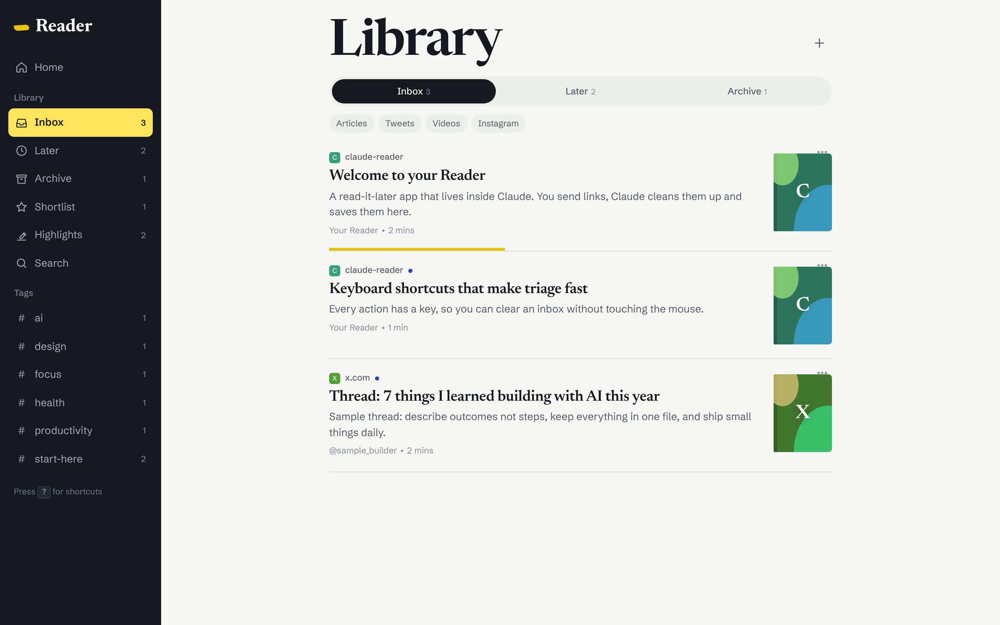
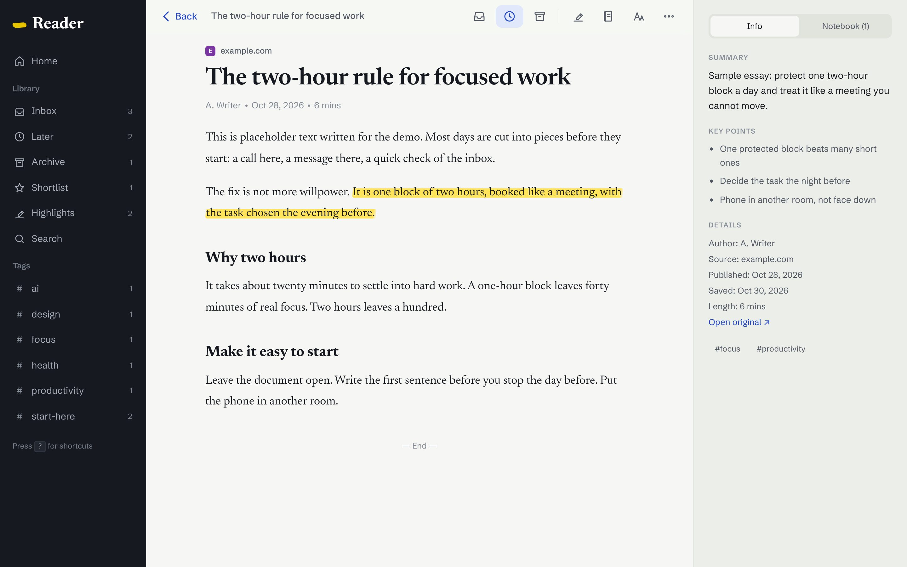
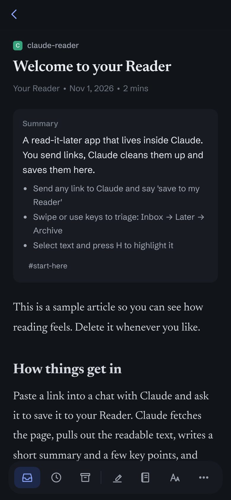
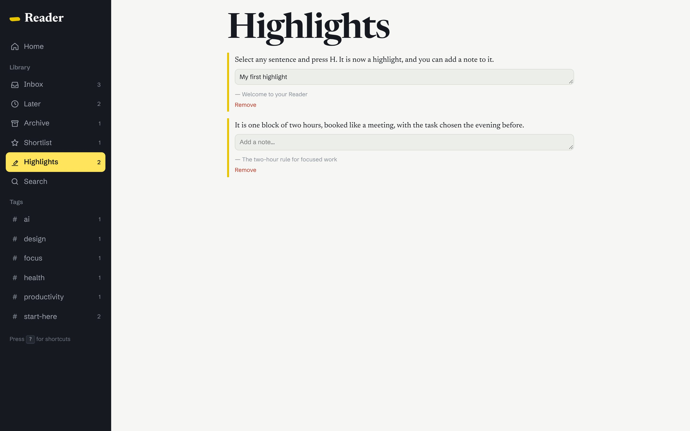
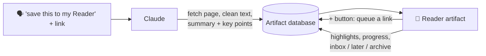

<div align="center">

# 📖 Reader: a Claude artifact

**A Readwise-style read-it-later app that lives inside [Claude](https://claude.ai).**
Send Claude a link. It cleans it up, summarises it and drops it in your Reader. Highlight, triage and keep going. ✨


### 👉 [**Try the live demo**](https://nitezr.github.io/claude-reader/)



</div>

---

## ☕ What it does

- 🔗 **Save anything**: articles, tweets and threads, YouTube videos, Instagram posts. Just tell Claude "save this to my Reader".
- 🧾 **Clean reading view**: big serif type and no ads. It remembers where you stopped.
- 🖍️ **Highlights**: select text and press **H**. Add notes, then review them all in one place.
- 📥 **Triage like email**: Inbox → Later → Archive, plus a ⭐ Shortlist and tags.
- 🧠 **Summary and key points** on every item, written by Claude when it saves.
- ⌨️ **Keyboard-first**: `j` `k` `e` `l` `h` `?`. Swipe on a phone.
- ☁️ **Syncs everywhere** through the artifact's built-in database.

| Reading view | Phone | Highlights |
|---|---|---|
|  |  |  |

> Everything in the screenshots is **sample content** written for the demo.

## 🧠 How it works



- **`artifact/index.html`**: the whole app in one file. No framework and no build step.
- **Database collections**: `docs` (saved items), `highlights`, and `queue` (links you add from inside the app).
- **Claude does the heavy lifting**: fetching, cleaning, summarising. The skill in `skill/reader-save` tells it exactly how.

## 🚀 Make your own (no coding)

**1. Try the demo** (optional; this is the only step that needs Terminal)
```bash
npx serve artifact      # or: cd artifact && python3 -m http.server
```
It runs in *demo mode* with sample articles, saved in your browser only.

**2. Publish it as your own Claude artifact.** Attach `artifact/index.html` to a Claude chat and paste:

```text
Publish this file as a new artifact called "Reader".
Declare the db capability with read: admin and write: admin, so only I can read or change it.
```

The first time it opens, it adds a few sample articles so it doesn't look empty.

**3. Teach Claude to save links.**
- Add the `skill/reader-save` folder as a skill in Claude (Settings → Capabilities → Skills).
- Paste your artifact link into its `SKILL.md`.
- Then:

```text
save this to my Reader: https://paulgraham.com/greatwork.html
```
```text
process my Reader queue
```

## 🎨 Remix ideas (just ask Claude)

- "Add a dark sepia theme for night reading."
- "Show a weekly 'what I read' stat on the home page."
- "Export all my highlights as Markdown with a Copy button."
- "Add a Daily Review that shows me 5 random old highlights."

## 📁 Repo map

```
artifact/
  index.html          ← the app (sample articles built in)
skill/reader-save/
  SKILL.md            ← tells Claude how to save links
docs/                 ← screenshots
```

## 🙏 Credits

- Inspired by Readwise Reader. Not affiliated.
- Fonts: Newsreader and Schibsted Grotesk (Google Fonts).
- Built by [@nitezr](https://github.com/nitezr) by talking to Claude. Sister project: [claude-watchlist](https://github.com/nitezr/claude-watchlist) 🎬

MIT licensed. Fork it, theme it, make it yours.
